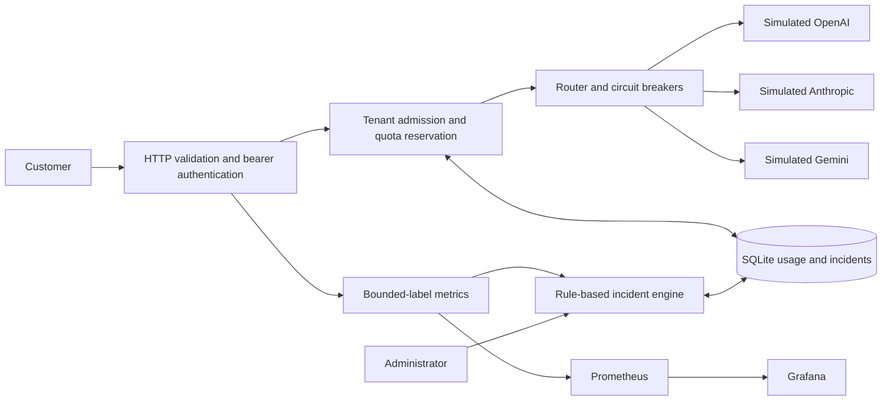
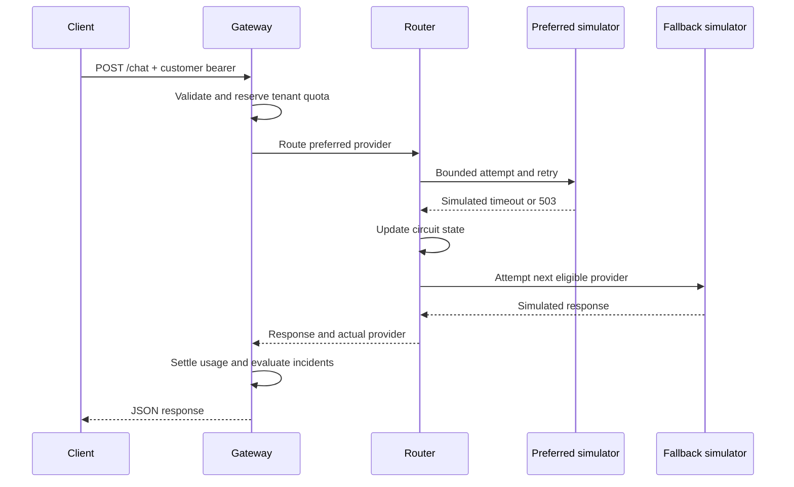
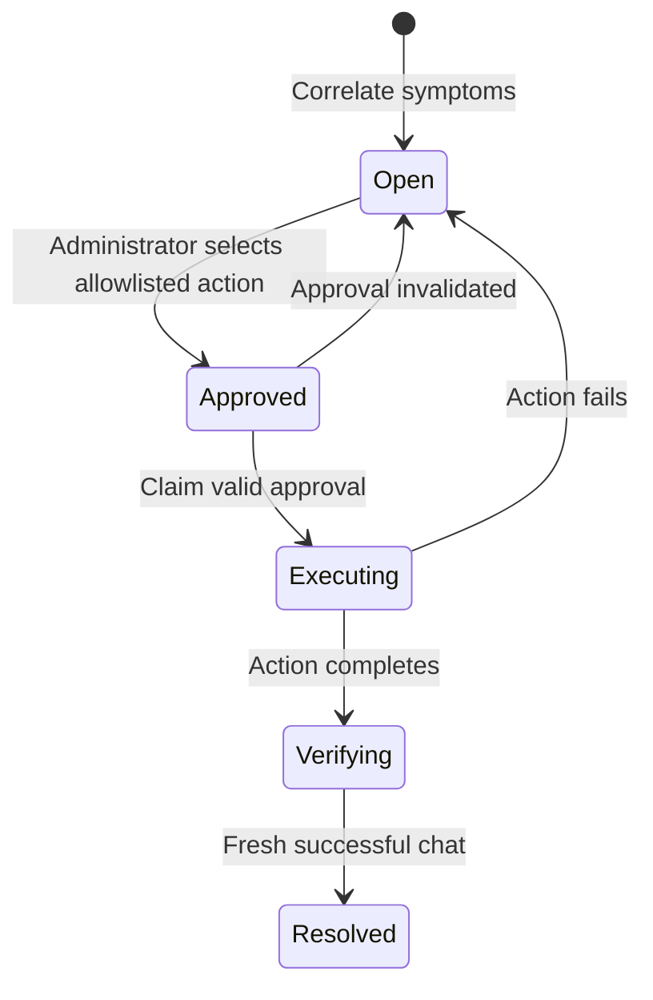
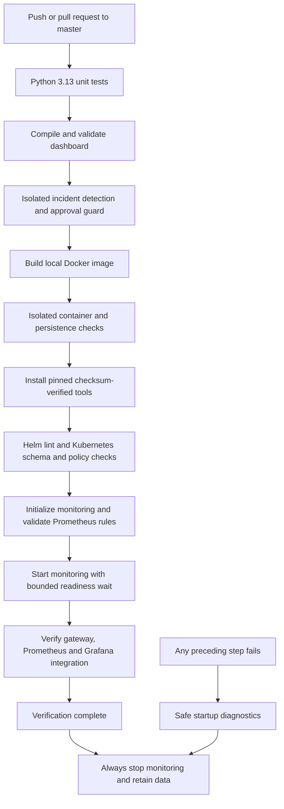
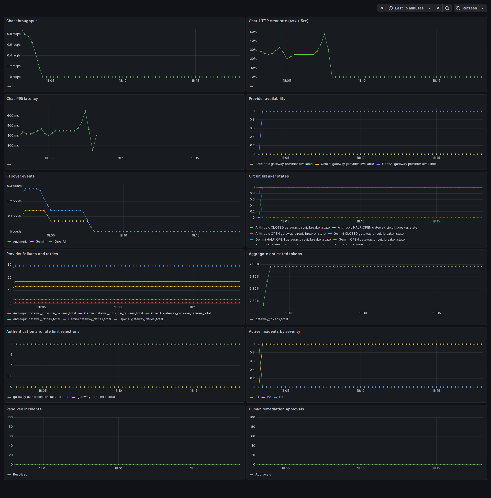
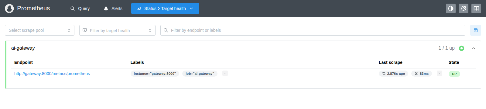
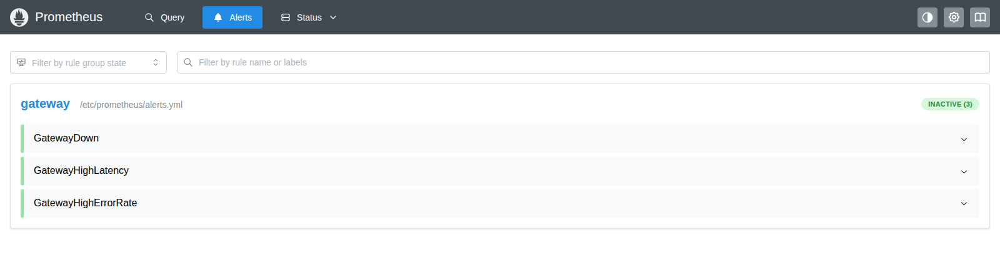
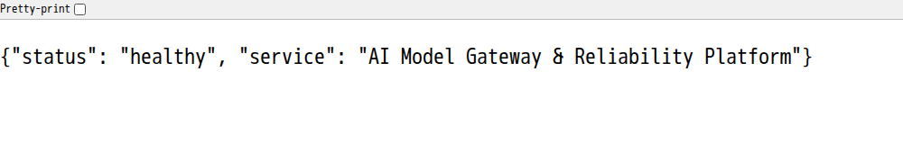
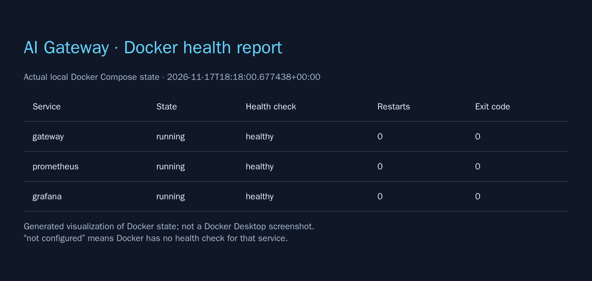
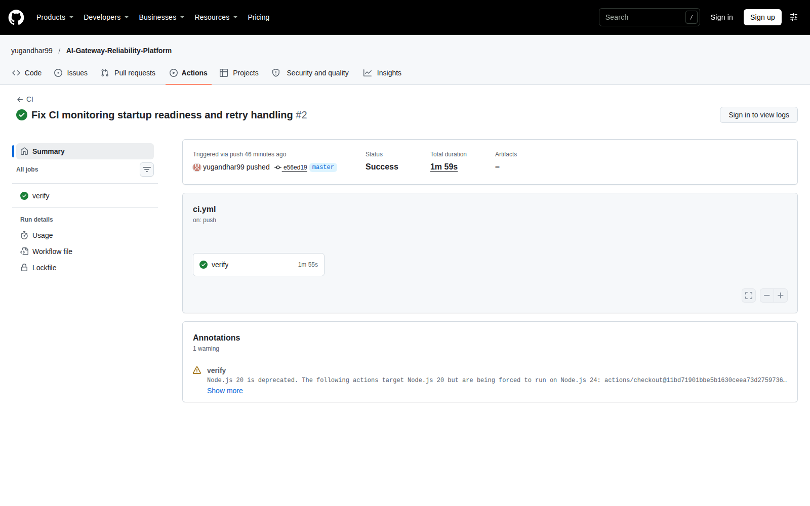

<p align="center"></p>

<h1 align="center">AI Gateway & Reliability Platform</h1>
<p align="center">An independent engineering portfolio project exploring resilient AI infrastructure.</p>
<p align="center">
<a href="https://github.com/yugandhar99/AI-Gateway-Reliability-Platform/actions/workflows/ci.yml"></a>


</p>

## Overview

A Python HTTP gateway that demonstrates provider routing, bounded retries, circuit breakers, tenant accounting, authenticated monitoring, and approval-controlled incident recovery. It packages the same application for local Python, Docker Compose, and single-replica Kubernetes deployments.

**OpenAI, Anthropic, and Gemini are entirely simulated.** No provider SDKs, external model calls, or real AI inference are implemented. AIOps uses deterministic rules and fixed recommendations. Deployment assets are included; no cloud or production deployment is claimed.

## Business use cases

- Explore continuity when an AI dependency times out or returns errors.
- Demonstrate tenant rate limits and reserved token budgets before admitting requests.
- Practice incident detection, operator approval, and evidence-based recovery.
- Evaluate container hardening, persistent accounting, and observable service design.

## Key highlights

- Preferred-provider routing with deterministic fallback and concurrency-safe circuit state.
- Distinct customer, administrator, and Prometheus bearer credentials.
- SQLite transactions for atomic quota reservations and persistent incident audit records.
- Non-root images, Kubernetes restricted security settings, retained storage, and one replica.
- Twelve provisioned Grafana panels, Prometheus alert rules, and rule fixtures.
- Recovery approvals expire after five minutes and cannot be reused after execution.

## Architecture





See [architecture](docs/architecture.md), [API reference](docs/api.md), [deployment guide](docs/deployment.md), and [incident runbook](docs/runbooks/incidents.md).

## Technology stack

| Area | Implementation |
|---|---|
| Application | Python standard library: http.server, threading, argparse, JSON |
| Storage | SQLite; transactional admission, usage and incident audit tables |
| Reliability | Custom router, per-provider locks, simulated timeouts and failures |
| Security | Bearer keys, SHA-256 digests, constant-time comparison, role separation |
| Containers | Python 3.13 slim Bookworm, Docker, Docker Compose |
| Orchestration | Kubernetes manifests, Helm chart; Kubernetes 1.34 schema validation |
| Monitoring | Prometheus 3.7.3, Grafana 12.3.0, provisioned dashboard and alerts |
| Automation | GitHub Actions, unittest, Helm 3.19.0, kubeconform 0.8.0, PyYAML 6.0.3 |

The application has no third-party Python runtime dependencies. PyYAML is needed only for infrastructure validation.

## Repository structure

```text
.github/workflows/ci.yml     Automated verification; no image publishing
charts/ai-gateway/           Helm chart and values schema
gateway/                    HTTP, routing, security, usage, metrics, incidents
k8s/                        Raw manifests and empty Secret example
monitoring/                 Prometheus rules, fixtures and Grafana provisioning
scripts/                    Validation, setup, traffic and incident tools
tests/                      Automated Python tests
docs/                       Architecture, API, deployment, validation and audit
docs/screenshots/           Automated runtime captures and provenance
Dockerfile                  Non-root application image
compose.yaml                Local gateway on loopback port 8002
compose.monitoring.yaml     Gateway 8003, Prometheus 9090, Grafana 3000
```

## Quick start

Prerequisites: Git and Python 3.13 (CI version). Docker Engine with Compose v2 or compatible is needed for container workflows. Commands below use a POSIX shell and `python3`.

```bash
git clone https://github.com/yugandhar99/AI-Gateway-Reliability-Platform.git
cd AI-Gateway-Reliability-Platform
python3 -m venv .venv
. .venv/bin/activate
export GATEWAY_STARTER_API_KEY="$(python3 -c 'import secrets; print(secrets.token_urlsafe(32))')"
export GATEWAY_ADMIN_API_KEY="$(python3 -c 'import secrets; print(secrets.token_urlsafe(32))')"
export GATEWAY_METRICS_API_KEY="$(python3 -c 'import secrets; print(secrets.token_urlsafe(32))')"
python3 -m gateway.server --host 127.0.0.1 --port 8000 --usage-db usage.sqlite3
```

Keep this terminal running. Use another terminal for public health checks. For authenticated examples, run the server in the background in the same shell or securely supply the same credentials to the client shell; generating new values will not authenticate to an existing process.

```bash
curl --fail http://127.0.0.1:8000/health
curl --fail http://127.0.0.1:8000/providers
curl --fail http://127.0.0.1:8000/chat \
  -H "Authorization: Bearer $GATEWAY_STARTER_API_KEY" \
  -H 'Content-Type: application/json' \
  -d '{"prompt":"Explain circuit breakers","provider":"OpenAI"}'
curl --fail http://127.0.0.1:8000/usage \
  -H "Authorization: Bearer $GATEWAY_STARTER_API_KEY"
```

The chat response contains `response`, `provider`, `status`, and measured `response_time_ms`. The response text explicitly identifies simulation. See [all endpoints and error examples](docs/api.md).

## Security

Customer, administrator, and metrics endpoints use separate bearer credentials. SQLite transactions reserve tenant quota before routing and settle usage afterward. Keys are hashed in memory; accounting and metric labels exclude prompt text and credentials. Containers run as a non-root user; Kubernetes manifests restrict privileges and require one replica.

See the [security policy](SECURITY.md) for reporting, credential handling, and implementation boundaries, and the [development guide](docs/development.md) for tier limits and routing defaults.

## Deployment and monitoring

```bash
# Uses the customer key exported above; loopback port 8002
docker compose up -d --build --wait
# Retains accounting volume
docker compose stop

# Separate monitoring environment and credentials
python3 scripts/setup_monitoring.py
docker compose --env-file .env.monitoring -f compose.monitoring.yaml up -d --build
python3 scripts/check_monitoring.py
docker compose --env-file .env.monitoring -f compose.monitoring.yaml stop
```

Prometheus scrapes `/metrics/prometheus` using a dedicated mounted credential. Grafana is at `http://127.0.0.1:3000`, username `admin`; retrieve the generated password privately from `secrets/monitoring/grafana`. The [monitoring guide](docs/monitoring.md) maps all twelve panels to their operational purpose and links the provisioned dashboard. Alerts cover scrape availability, P95 latency above 500ms, and chat 5xx rates above 10%.

Follow the [deployment guide](docs/deployment.md) for Docker smoke tests, namespace and Secret creation, image loading, storage prerequisites, raw Kubernetes installation, Helm installation, rollback, and monitoring validation. GitHub Actions builds and tests locally within CI; it does not push images or deploy a cluster.

## AIOps and human-approved recovery



The diagram shows the operator workflow; `Approved` represents a separate approval record while the incident remains open or verifying. Expiry and evidence changes cause execution to be rejected. Incidents remain in verification until recovery criteria are met.

Detection evaluates a rolling 60-second chat window and provider state. It classifies incidents as P1/P2/P3 and persists evidence, recommendations, approvals, and audit events. No shell, LLM, Kubernetes controller, or external recovery command executes. Optional mock restoration must be enabled at startup and approved by an administrator. [Runbook](docs/runbooks/incidents.md).

## CI/CD pipeline architecture



The [existing CI workflow](.github/workflows/ci.yml) remains unchanged. The live badge reports hosted status; the local evidence below is recorded separately. Delivery assets support manual Compose and Kubernetes/Helm deployment; automated image publishing and cluster deployment are future work.

## Testing

Final verification passed **70 Python tests**, all **13 container smoke checks**, compilation, dashboard and infrastructure validation, Prometheus alert fixtures, live monitoring integration, and isolated HTTP incident detection with the approval guard. Host Python was 3.14.4; CI targets Python 3.13. The [validation record](docs/validation.md) records the checks and their limits; they do not establish a cloud deployment or production readiness.

```bash
python3 -m unittest discover -v
python3 -m compileall -q gateway scripts tests
python3 scripts/validate_incident_dashboard.py
```

See [development and troubleshooting](docs/development.md) for infrastructure tools and simulation commands.

## Monitoring and screenshots

The [monitoring guide](docs/monitoring.md) documents all twelve Grafana panels, alert thresholds, and Prometheus target checks. [Screenshot automation](docs/screenshots/README.md) captures the running stack with Playwright and headless Chromium, generates synthetic traffic, and builds a visual report from actual Docker container status. It also attempts to capture a verified successful public GitHub Actions run.

```bash
.venv-screenshots/bin/python scripts/capture_screenshots.py
```

See the [installation and execution commands](docs/screenshots/README.md) first. Successful captures automatically populate the gallery below with professional descriptions and capture provenance.

<!-- BEGIN GENERATED SCREENSHOTS -->

**Grafana AI Gateway dashboard**

All twelve provisioned panels, captured after synthetic normal, outage, timeout and recovery traffic. Zero incident approvals are valid: the capture does not approve remediation.



**Prometheus targets**

Actual scrape target state for the authenticated AI Gateway metrics endpoint.



**Prometheus alert rules**

Loaded alert rules and their current evaluation state; this does not imply an alert is firing.



**AI Gateway health endpoint**

Live /health response from the local gateway. This endpoint reports process liveness.



**Docker container health report**

A generated visual report of actual Compose container state, restart count, exit code and configured health checks. Containers without a health check are labeled explicitly.



**Successful GitHub Actions workflow**

A public GitHub Actions run verified as completed successfully through the GitHub API before capture. The run revision is recorded in provenance; local documentation commits require their own hosted run.



[Capture provenance](docs/screenshots/capture.json). Screenshots show a local simulated workload, not a production deployment.

<!-- END GENERATED SCREENSHOTS -->

## Limitations and project roadmap

The standard-library HTTP server is a teaching implementation without built-in TLS, request read timeouts, or a production concurrency limit. `/health` checks process liveness, not provider or storage readiness. Metrics and circuit state reset on restart. SQLite and process-local routing require one replica; updates use Recreate and may interrupt service. No streaming, real provider calls, production tokenizer, billing integration, external alert delivery, or cloud deployment is included. Approval uses a shared admin key and does not enforce two-person separation of duties.

Planned work, with no delivery dates committed:

- [ ] Real provider adapters, cancellation, retry backoff and streaming.
- [ ] Production HTTP serving, TLS ingress, request limits and network policies.
- [ ] OIDC tenant identities and independently authenticated approvers.
- [ ] PostgreSQL, shared routing state and multiple replicas.
- [ ] Load testing, distributed tracing and external incident notifications.
- [ ] Reviewed image publishing and deployment automation.

## Project documentation

- [Development and troubleshooting](docs/development.md)
- [Architecture and design tradeoffs](docs/architecture.md)
- [API reference](docs/api.md)
- [Installation and deployment](docs/deployment.md)
- [Monitoring dashboards and alerts](docs/monitoring.md)
- [Incident runbooks](docs/runbooks/incidents.md)
- [Validation evidence](docs/validation.md)
- [Publication audit](docs/publication-audit.md)
- [Security policy](SECURITY.md) · [Changelog](CHANGELOG.md) · [Screenshot guidance](screenshots/README.md)

Historical privacy findings remain unresolved; consult the publication audit before publishing Git history. No license has been selected; do not assume an open-source reuse license.

<p align="center"><a href="https://github.com/yugandhar99">GitHub portfolio</a> · Built to demonstrate practical platform engineering.</p>
