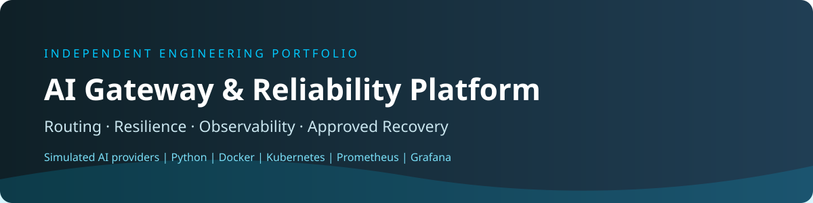
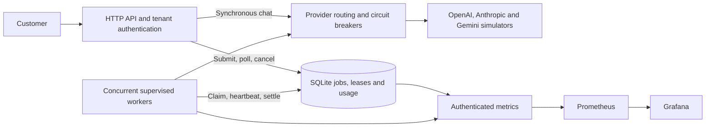
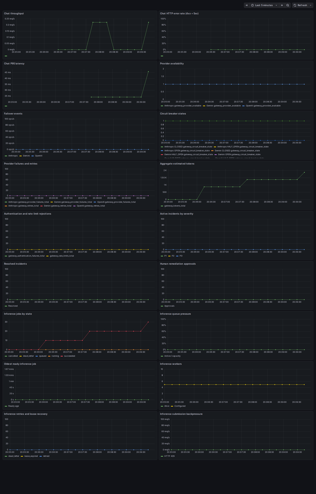

<p align="center"></p>

# AI Inference Orchestration Platform
 
An independent engineering portfolio project demonstrating durable asynchronous inference, tenant isolation, and failure recovery. The original synchronous gateway remains available through `POST /chat`. OpenAI, Anthropic, and Gemini are deterministic simulators. Deployment and validation target a single host.

[](https://github.com/yugandhar99/AI-Gateway-Reliability-Platform/actions/workflows/ci.yml)


## Architecture



- Admission checks tenant and global capacity, then commits the job and its token reservation together. Replaying the same tenant-scoped idempotency key returns the existing job. A changed request under the same key returns HTTP 409.
- Workers claim from a persistent priority queue. Aging moves long-waiting eligible jobs ahead of fresh arrivals. Heartbeats renew leases, and only the current live claim can commit a result and its usage charge.
- Expired leases are recovered during worker polling. Failures reschedule with capped exponential backoff. Exhausted jobs remain in a durable dead-letter state, and full queues return HTTP 429 with `Retry-After`.
- The same router serves chat and queued jobs. It supports provider retries, failover, and circuit breakers. Deterministic incident detection retains administrator-approved recovery.

[Workflow diagrams and guarantees](docs/architecture.md) · [Inference runbook](docs/runbooks/inference.md)

## Version 1.0 versus Version 2.0

| Area | Version 1.0 gateway baseline | Version 2.0 |
|---|---|---|
| API | Synchronous chat | Chat plus asynchronous submit, status, result, and cancel |
| Scheduling | Request-thread execution | Persistent priority queue with aging and concurrent workers |
| Accounting | Tenant quota reservations around chat | Shared ledger with tenant-scoped idempotency and atomic job settlement |
| Failure recovery | Provider retries, failover, circuit breaking | Renewable leases, stale-worker fencing, retry backoff, and durable dead letters |
| Admission | Tenant request-rate and token quotas | Additional tenant and global active-job capacity limits |
| Observability | 12 Grafana panels for gateway and incidents | 18 panels including queue pressure, ready age, worker slots, retry and recovery trends |
| Validation | 70 tests and 13 container smoke checks | 83 tests, 30 container smoke checks, and a 100-job five-worker integration |

## Quick start

From the repository root, start a loopback gateway with a generated demo key.

```bash
export GATEWAY_STARTER_API_KEY="$(python3 -c 'import secrets; print(secrets.token_urlsafe(32))')"
python3 -m gateway.server --host 127.0.0.1 --port 8000 --usage-db usage.sqlite3 --workers 2 &
gateway_pid=$!
curl -fsS --retry 5 --retry-connrefused http://127.0.0.1:8000/health
```

Submit a job and use its returned status URL.

```bash
base=http://127.0.0.1:8000
auth="Authorization: Bearer $GATEWAY_STARTER_API_KEY"
job_path="$(curl -fsS -D - -o /dev/null "$base/jobs" \
  -H "$auth" -H 'Content-Type: application/json' \
  -H 'Idempotency-Key: portfolio-demo-1' \
  -d '{"prompt":"Explain circuit breakers","provider":"OpenAI","priority":7}' \
  | awk 'tolower($1) == "location:" {sub(/\r$/, "", $2); print $2}')"
curl -fsS "$base$job_path" -H "$auth"
sleep 1
curl -si "$base$job_path/result" -H "$auth"
```

If the result returns HTTP 202, poll again after the interval in
`Retry-After`. Stop the demo with `kill "$gateway_pid"`.

[API examples and response codes](docs/api.md) · [Docker Compose, Kubernetes, and Helm deployment](docs/deployment.md)

## Release validation

| Check | Recorded result |
|---|---|
| Python unit and HTTP suite | 83 passing tests |
| Isolated Docker smoke suite | 30 passing checks covering persistence, restart, replacement, and SIGTERM drain |
| Concurrent inference | 100 of 100 jobs accepted across three tenants and completed on their first claim by a five-worker pool |
| Fault scenarios | Concurrent duplicate submission, tenant isolation, stale-worker fencing, SIGKILL recovery, failover, backpressure, cancellation, and dead-letter persistence passed |
| Monitoring | 18 provisioned Grafana panels and 19 PromQL queries verified in an isolated monitoring stack |

The integration checked exactly 100 simulator calls and zero outstanding reservations after drain. The GitHub Actions workflow includes the live inference validator and expanded container smoke checks alongside the existing infrastructure and monitoring steps. The badge reflects hosted runs on `master`. [Reproduction commands and measured results](docs/validation.md)

## Monitoring screenshots

<!-- BEGIN GENERATED SCREENSHOTS -->

Captured from a fresh, isolated Docker Compose deployment with five workers
and synthetic chat and job traffic.



[Prometheus targets](docs/screenshots/v2/prometheus-targets.png) ·
[Prometheus alert rules](docs/screenshots/v2/prometheus-alerts.png) ·
[Capture provenance](docs/screenshots/v2/capture.json) ·
[Historical Version 1.0 gallery](docs/screenshots/README.md#historical-gallery)

<!-- END GENERATED SCREENSHOTS -->

## Operating boundaries

SQLite stores prompts, results, queues, and usage locally. Use persistent storage and a single deployment replica. Execution can repeat after lease expiry, while only one winning result and charge can commit. Terminal records accumulate until a retention policy is implemented. The demo HTTP server requires upstream connection controls and TLS for external exposure. The burst and fault exercises measure a local simulated workload.

- [Inference operations](docs/runbooks/inference.md) and [incident response](docs/runbooks/incidents.md)
- [Development guide](docs/development.md) and [security policy](SECURITY.md)
- [Changelog](CHANGELOG.md) and [v2.0.0 release notes](docs/release-notes/v2.0.0.md)
- [Publication audit and unresolved historical findings](docs/publication-audit.md)
