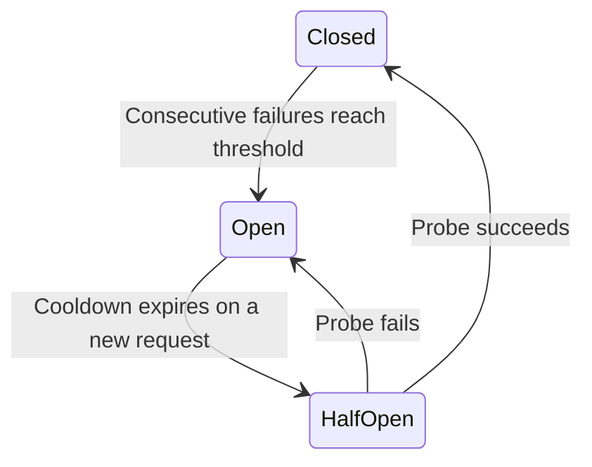

# Architecture and design

The HTTP adapter (`gateway/server.py`) validates methods, content type, body size (65,536 bytes) and JSON before dispatch. Chat validation limits prompts to 10,000 characters. Public routes expose health and the simulated provider catalog. Customer, admin and scrape routes use separate bearer roles.

`security.py` hashes configured keys in memory and compares digests with constant-time comparison. The environment registry maps one configured key per tier to a fixed demo customer ID. `usage.py` uses SQLite `BEGIN IMMEDIATE` to reserve token capacity atomically and settle each admission once. Prompts and keys are not persisted by accounting; the database does contain customer IDs, timestamps, counters, process metadata and incident evidence and must remain private.

`reliability.py` keeps policy and per-provider state in one process. The preferred provider precedes remaining registry entries. Attempts are bounded by `max_retries + 1`; failures count per attempt. Locks prevent simultaneous half-open probes. Generation checks keep stale in-flight outcomes from overwriting newer circuit state. Retries have no backoff. The timeout is a simulated sleep and failure, not a real HTTP deadline.



Live simulation files accept provider names with outcome sequences: `success`, `503`, or `timeout`. The final outcome repeats. Updating the JSON resets sequence positions. Missing/unreadable or invalid configured files produce a fixed simulation error; no upstream traffic occurs.

Example startup policies (`--config`, loaded once):

```json
{"OpenAI":{"timeout_seconds":0.2,"max_retries":1,"failure_threshold":3,"recovery_seconds":5}}
```

Example live scenario (`--simulation-file`):

```json
{"OpenAI":["503","503","success"],"Anthropic":["success"]}
```

`observability.py` records bounded route/method/status/provider labels without prompt, bearer or customer labels. Prometheus scrape authentication is independent of admin authentication. Incident evaluation runs after chats, on authenticated scrapes, or through the explicit evaluate endpoint; it is not a background scheduler. Incident state persists in the accounting database, while recent telemetry is process-local.

The incident engine correlates one active routing incident, rather than creating an incident per request. Recommendations are fixed allowlisted actions. Approvals bind incident revision, action and expiry, and execution is durably claimed before side effects. Interrupted execution is not automatically replayed. Recovery requires a separate verification step.

## Deployment boundaries

Kubernetes and Helm intentionally require a single replica, a Recreate strategy and ReadWriteOncePod storage. This avoids unsupported distributed circuit/metric state and concurrent deployments against the same local database. The chart rejects multiple replicas; its PVC has a keep annotation. Raw manifests have no Helm retention behavior. `/health` is used for probes but does not establish upstream or database readiness.

Containers run as UID/GID 10001. Kubernetes drops capabilities, disables privilege escalation and service-account token mounting, enables RuntimeDefault seccomp and mounts a writable data volume under a read-only root. Compose monitoring uses file-mounted secrets and loopback host bindings. These controls do not provide TLS, encrypted secrets, tenant-specific network isolation, or production traffic hardening.
